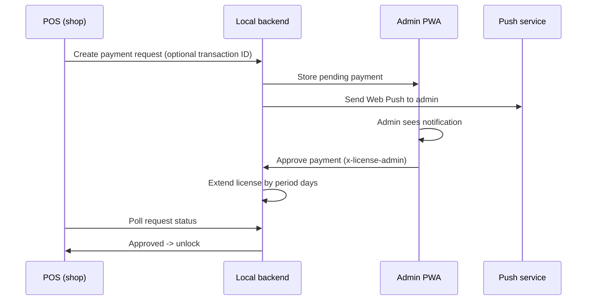
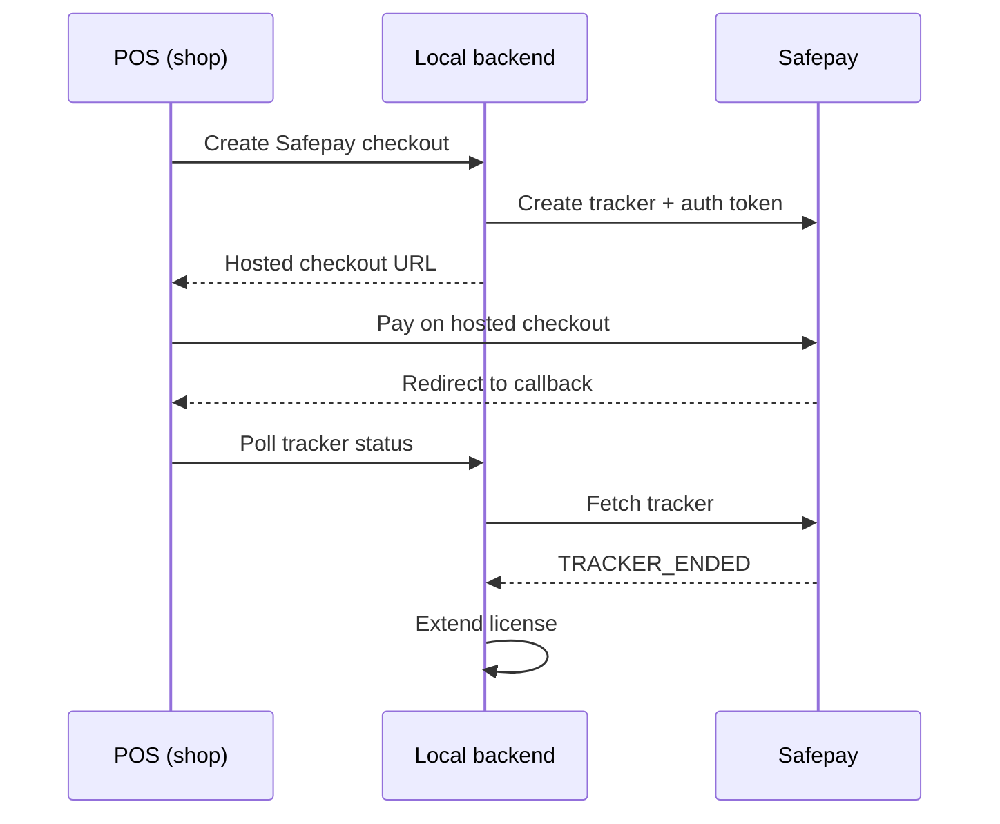

## Summary

What does this PR do and why.

## Requirements before merge

Check every item before merging:

- [ ] Backend typecheck passes (`cd backend && npx tsc --noEmit`)
- [ ] Frontend typecheck passes (`cd frontend && npx tsc --noEmit`)
- [ ] Admin typecheck passes (`cd web && npx tsc --noEmit`)
- [ ] Local payment flow tested end to end
- [ ] No secret values in tracked files (check `git ls-files` for `.env`)
- [ ] Release notes updated under `docs/RELEASE_NOTES.md` `## Unreleased`
- [ ] Docs updated (`docs/architecture.md`, `docs/WEB_LICENSING_FLOW.md`)
- [ ] No `--` or `—` in release notes
- [ ] PR description lists new environment variables

## Environment variables

List new or changed environment variables:

| Variable | Where | Required | Description |
|---|---|---|---|
| `EXAMPLE_VAR` | backend | yes | Short description |

## Tests

What was tested and how:

- [ ] Manual test steps
- [ ] Commands to run

## Payment flow

### New manual account/QR flow

### Previous Safepay checkout flow (kept for reference)

## Rollback

How to roll this back if needed.

## Screenshots / recordings

Add any UI screenshots.
